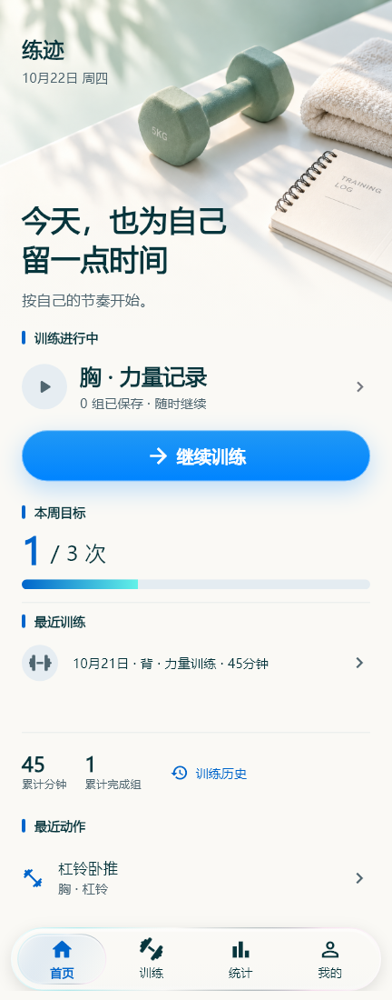
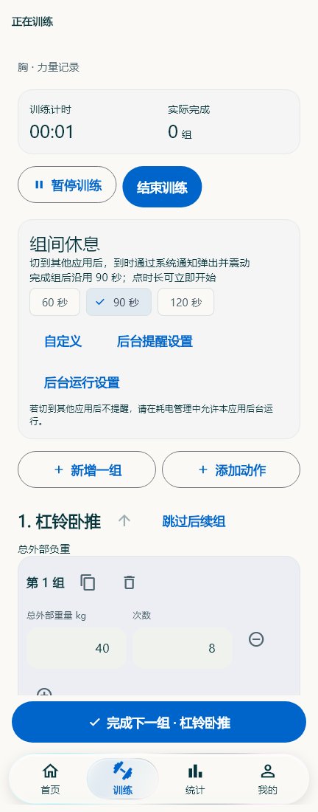
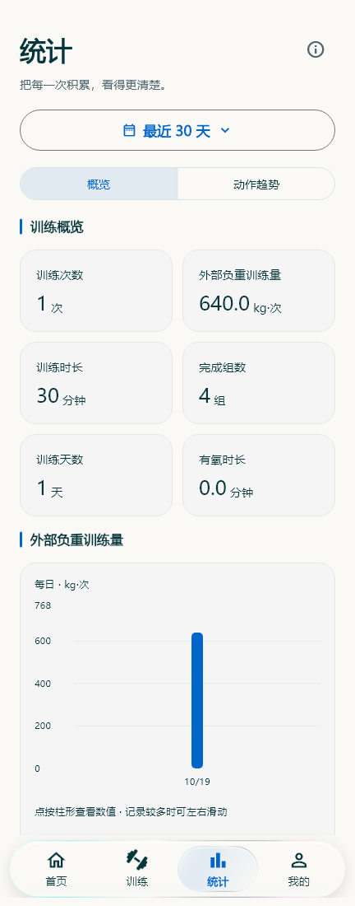
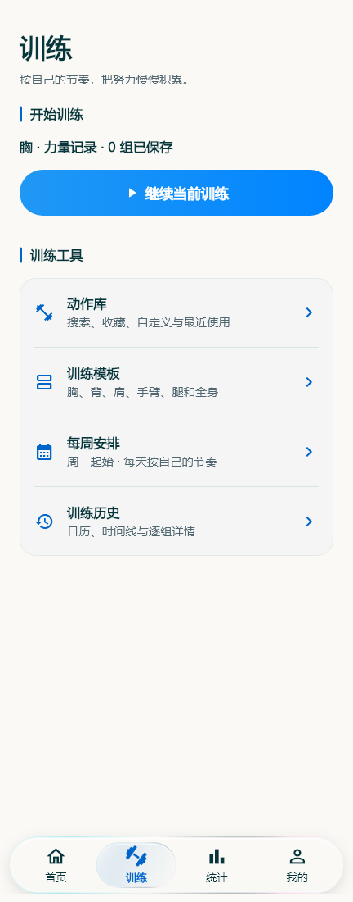
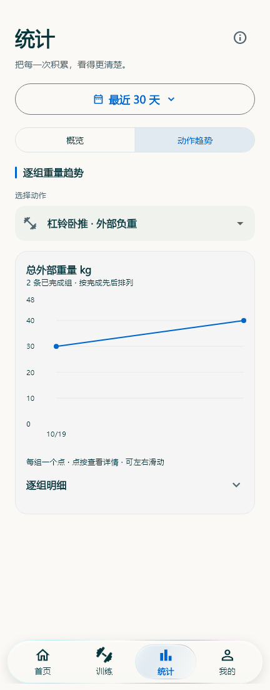
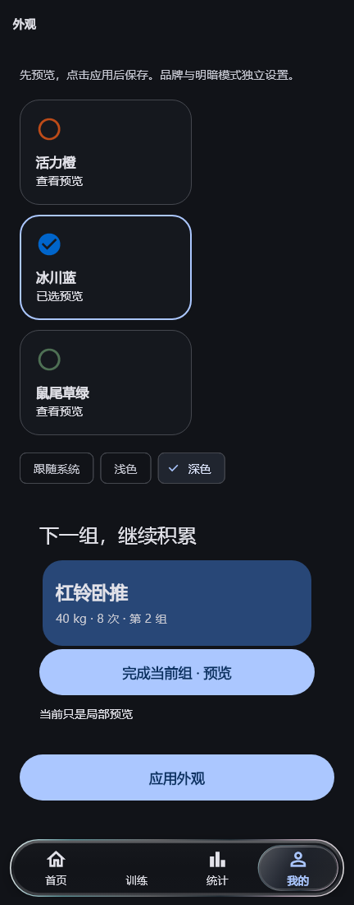

# LiftTrace · 练迹

一款面向 Android 的离线训练日志，用来记录每一组训练、安排训练计划，并查看自己的进步。

无需注册账号，核心功能可离线使用。训练记录保存在设备本地，可自行导出备份，或连接 WebDAV 服务备份。

[下载安装](https://github.com/Yiixuan6/LiftTrace/releases/latest) · [反馈问题](https://github.com/Yiixuan6/LiftTrace/issues)

## 界面预览

以下为应用实际页面，截图中的训练记录均为演示数据。

| 首页 | 逐组记录 | 训练统计 |
| :---: | :---: | :---: |
|  |  |  |

| 训练与计划 | 动作趋势 | 深色外观 |
| :---: | :---: | :---: |
|  |  |  |

## 功能

- **逐组记录**：记录重量、次数、组数、训练感受和备注，支持复制上一组、暂停训练及继续未完成的训练。
- **多种训练类型**：支持外部负重、单双侧哑铃、辅助器械和有氧记录，分别处理不同的重量与训练量口径。
- **动作与计划**：内置动作库，支持搜索、筛选、收藏、自定义动作、训练模板和每周安排。
- **休息计时**：提供预设与自定义时长，可暂停、延长或跳过，支持系统通知和振动提醒。
- **历史与统计**：查看训练历史、完成组数、训练时长、训练量、肌群分布和单动作逐组趋势。
- **身体数据**：按日期记录体重及可选围度，查看变化趋势。
- **备份与恢复**：导出完整 JSON 备份或分析用 CSV，支持 WebDAV 手动及自动备份。
- **多语言**：简体中文、繁體中文、English 和跟随系统，在“我的 → 语言”即时切换；训练名称和备注保留原文。
- **外观设置**：冰川蓝、活力橙、鼠尾草绿三套配色，支持浅色、深色及跟随系统。

## v0.2 更新

- 新增简体中文、繁體中文、English 和跟随系统，可在“我的 → 语言”即时切换。
- 保留已有训练名称、动作名称和备注原文，切换语言不改写历史记录。
- 修复已保存休息时长偏好时，旧版可能无法读取数据或备份的问题。

详细变化和兼容说明见 [v0.2 发布说明](docs/releases/v0.2.md)。

## 下载与安装

需要 **Android 8.0 或更新版本**，支持简体中文、繁體中文和 English。

1. 打开 [Releases](https://github.com/Yiixuan6/LiftTrace/releases)。
2. 下载对应版本的 `.apk` 文件，按 Android 提示允许安装。
3. 打开“练迹”，从首页开始自由训练，或先创建训练模板。

公开版本与 Android 内部版本分别编号：**v0.2** 对应 **0.2.11（13）**，**v0.1** 对应 **0.2.10（12）**。安装包以 Releases 中实际发布的版本为准。

更新前建议在“我的 → 备份与恢复”导出完整 JSON。使用相同来源、相同签名的安装包覆盖更新；卸载应用会删除本地数据。

## 使用提示

- 在训练页输入重量和次数后，确认完成该组；复制出的组默认尚未完成。
- 哑铃重量按单只填写，左右次数按实际完成填写；辅助器械的辅助重量单独统计。
- 休息提醒需要允许通知及相关提醒权限。部分手机还需允许应用在后台运行，勿扰模式和省电策略可能影响提醒。
- **JSON 用于完整恢复，CSV 用于分析**。完整恢复会替换当前数据，确认前请检查备份内容。
- WebDAV 提供备份与恢复；多设备双向同步尚未提供。不同服务及手机后台策略的兼容性仍需实际验证。

## 数据与隐私

核心记录保存在应用本地 SQLite 数据库，无需账号或自建服务器。系统自动云备份已关闭；WebDAV 自动备份默认关闭，需自行配置并开启。

导出的 JSON 和 CSV 为明文文件，请保存到自己信任的位置。WebDAV 凭据使用 Android 安全存储，不包含在完整 JSON 备份中；换机后需重新配置。

## 从源码运行

项目使用 Flutter、Riverpod、go_router、SQLite 和 Material 3。

当前开发基线：Flutter **3.47.7**、Dart **3.13.5**、JDK **17**、Android SDK **36**。完整版本信息见 [toolchain.lock.json](docs/toolchain.lock.json)。Windows 下建议使用不含中文和空格的项目路径。

准备好 Flutter 与 Android 开发环境，连接安卓设备或启动模拟器后：

```sh
git clone https://github.com/Yiixuan6/LiftTrace.git
cd LiftTrace
flutter pub get
flutter run
```

静态检查与默认测试：

```sh
flutter analyze
flutter test
```

正式 APK 构建需另行配置发布签名；仓库不包含签名私钥。构建细节见 [构建说明](docs/BUILD.md)。

## 项目结构

| 目录 | 内容 |
| --- | --- |
| `lib/domain/` | 数据模型与统计算法 |
| `lib/data/` | SQLite 仓储、备份格式与 WebDAV |
| `lib/application/` | 应用状态与业务流程 |
| `lib/platform/` | 通知、后台任务及 Android 能力 |
| `lib/ui/` | 页面、主题与组件 |
| `test/` | 单元测试与组件测试 |
| `integration_test/` | Android 集成测试 |
| `assets/` | 图片、图标、着色器与素材许可 |

更多技术细节见 [架构说明](docs/ARCHITECTURE.md)。第三方素材署名及许可见 [assets/licenses](assets/licenses) 和 [docs/licenses](docs/licenses)。

## 反馈

遇到问题或有功能建议，欢迎提交 [Issue](https://github.com/Yiixuan6/LiftTrace/issues)。描述手机型号、Android 版本和复现步骤，有助于定位问题；附截图或日志前请移除个人训练数据及服务凭据。
